<p align="center">
  
</p>

<p align="center">
  <a href="#about"><b>About</b></a> &nbsp;·&nbsp;
  <a href="#stack"><b>Stack</b></a> &nbsp;·&nbsp;
  <a href="#stats"><b>Stats</b></a> &nbsp;·&nbsp;
  <a href="#contact"><b>Contact</b></a>
</p>

<br/>

<a id="about"></a>

## About

<table>
  <tr>
    <td width="200" align="center" valign="middle">
      
    </td>
    <td valign="middle">

I'm a **full-stack developer** who builds AI-powered web applications and developer tools.
I like clean interfaces, reliable code, and turning ideas into things people can actually use.

```ts
const ashitosh = {
  role: "Full-Stack Developer",
  focus: ["AI-powered tools", "Frontend", "Developer tooling"],
  languages: ["TypeScript", "JavaScript", "Kotlin"],
  learning: "Building smarter products with LLMs",
};
```

    </td>
  </tr>
</table>

<br/>

<a id="stack"></a>

## Stack

<p align="center">
  
</p>

<p align="center">
  <sub>React · TypeScript · JavaScript · Tailwind CSS · Vite · Kotlin · Android · Spring Boot · MongoDB · Git · GitHub · VS Code · LaTeX</sub>
</p>

<br/>

<a id="stats"></a>

## Stats

<p align="center">
  
  &nbsp;
  
</p>

<br/>

<a id="contact"></a>

## Contact

<p align="center">
  <a href="https://github.com/Ashitosh2004"></a>
  <a href="https://linkedin.com/in/YOUR-LINKEDIN"></a>
  <a href="mailto:YOUR-EMAIL@example.com"></a>
</p>

<p align="center"><sub>Open to collaborating on AI and web projects.</sub></p>
