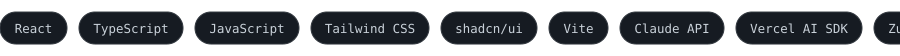

  

  
  
  

---

<table>
  <tr>
    <td width="190" align="center" valign="top">
      
    </td>
    <td valign="top">

### 👋 About

I'm a full-stack developer who builds **AI-powered web applications** and **developer tools**. I care about clean interfaces, reliable code and shipping things people actually use.

- 🔭 Building React apps with AI integrations
- 🧠 Working with the Claude API and the Vercel AI SDK
- 🛠️ Interested in developer tooling and browser-based editors
- 📄 Co-author of a research paper on AI-based emergency response

    </td>
  </tr>
</table>

---

### ⚡ Tech I work with

  

<b>See the full stack by area</b>

 

| Area | Technologies |
| :-- | :-- |
| **Frontend** | React 18, TypeScript, Tailwind CSS, shadcn/ui, Vite |
| **AI** | Claude API, Vercel AI SDK |
| **Editor and Runtime** | Monaco Editor, Sandpack |
| **State and Storage** | Zustand, Dexie.js, MongoDB Atlas |
| **Backend and Mobile** | Spring Boot, Kotlin, Android (Room) |
| **Tools** | Git, GitHub, VS Code, LaTeX |

---

### 🚀 Selected work

<table>
  <tr>
    <td width="50%" valign="top">

#### 🚑 ResQAI
AI-based smart emergency alert and ambulance assistance system. An offline SOS flow for the phone owner, plus an online QR-scan and GPS flow for bystanders. Backed by a research paper.

`Kotlin` `Room` `Spring Boot` `MongoDB Atlas` `Twilio` `Sarvam Speech API`

    </td>
    <td width="50%" valign="top">

#### 🏗️ OpenBuilder AI
A free, open-source, browser-based AI website builder with a VS Code-style IDE, multi-provider AI engine, live preview and ZIP export.

`React` `TypeScript` `Zustand` `Dexie.js` `Monaco` `Sandpack` `Vercel AI SDK`

    </td>
  </tr>
  <tr>
    <td width="50%" valign="top">

#### 🩺 MediCare AI
A health companion web app powered by the Claude API, with local persistence and a clean interface.

`React` `Claude API`

    </td>
    <td width="50%" valign="top">

#### 📦 More
Prototypes and experiments live in my [repositories](https://github.com/Ashitosh2004?tab=repositories). Stars are always appreciated ⭐

    </td>
  </tr>
</table>

---

### 📊 Stats

  
  

  

---

### 🐍 Play: the snake eats my contributions

  <picture>
    <source media="(prefers-color-scheme: dark)" srcset="https://raw.githubusercontent.com/Ashitosh2004/Ashitosh2004/output/github-snake-dark.svg" />
    <source media="(prefers-color-scheme: light)" srcset="https://raw.githubusercontent.com/Ashitosh2004/Ashitosh2004/output/github-snake.svg" />
    
  </picture>

Regenerated every day by a GitHub Action. More commits means more snake food.

---

### 🎮 Take a break

  
  
  

---

### 📫 Let's connect

  
  
  

Thanks for stopping by. Have a great day! ✌️

